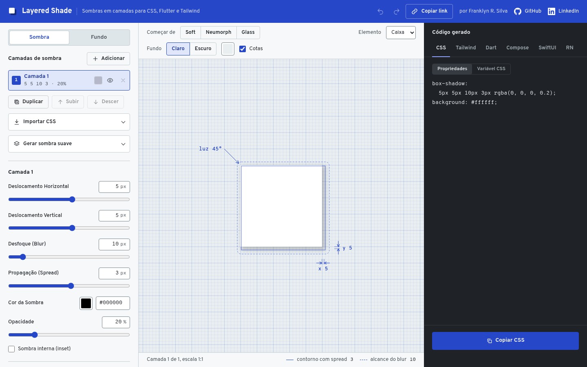

# Layered Shade

Build multi-layer box shadows visually and copy the same result as **CSS**, **Tailwind**, **Flutter/Dart**, **Jetpack Compose**, **SwiftUI** or **React Native**.

[🇧🇷 Português](docs/pt-BR/README.md)

[](https://layeredshade.netlify.app/)
[](https://github.com/Franklyn-R-Silva/Layered-Shade/actions/workflows/ci.yml)
[](LICENSE)
[](https://www.bestpractices.dev/projects/17195)



## Why

Most shadow generators stop at CSS. Layered Shade treats Flutter as a first-class target: one shadow model, three exports that agree, and the Flutter limits stated where they apply instead of being hidden.

## Features

### Shadows

- **Layers**: add, duplicate, reorder, hide and remove shadow layers; each has X/Y offset, blur, spread, color, opacity and inset.
- **Smooth shadow generator**: pick how many layers, the distance and the intensity, and it builds the stack (offset and blur double layer by layer) for the soft falloff one shadow cannot give.
- **Import CSS**: paste an existing `box-shadow`, a whole CSS rule or a Tailwind `shadow-[…]` class and keep editing it.
- **Measured preview**: the box is drawn 1:1 on a grid, and dimension lines show the selected layer's offset, its spread outline, how far the blur reaches and where the light comes from. Toggle them with **Cotas**.
- **Presets**: Soft, Neumorph and Glass as starting points.
- **Undo / redo** (Ctrl+Z, Ctrl+Shift+Z), and the last session is restored when you come back.

### Background and shape

- **Gradients**: stack linear and radial gradients with any number of color stops, over a solid base color.
- **Shape**: border radius; the preview canvas color is adjustable too.
- **Preview on a box, a card or a button**, on a light or a dark ground, always at 1:1.

### Export

- **CSS**: `box-shadow`, `background` and `border-radius`, one layer per line. The panel shows exactly what is copied, with the selected layer highlighted.
- **Dart/Flutter**: `BoxDecoration` with `BoxShadow` entries, ready to paste into a `Container`.
- **CSS variable**: the shadow as `--shadow-layered` for a token file.
- **Tailwind**: `shadow-[…]` and `bg-[…]` arbitrary-value classes, or a v4 `@theme` token (`shadow-layered`).
- **Jetpack Compose** (1.9+): `Modifier.dropShadow` / `innerShadow`.
- **SwiftUI**: one shape per shadow, inner shadows as `.shadow(.inner)` (iOS 16+).
- **React Native** (0.76+, New Architecture): `boxShadow` style with the CSS syntax.
- **Share link**: the whole shadow in a URL, to paste in a PR or a chat.
- **Copy**: one button for the active format, with a confirmation that screen readers announce.

## Known limitations

- **Flutter `inset`**: Flutter's `BoxShadow` has no inset. When a layer is inset, the Dart tab says so and gives the [`flutter_inset_box_shadow`](https://pub.dev/packages/flutter_inset_box_shadow) install command.
- **Several gradients in Flutter**: `BoxDecoration` takes one gradient, so the Dart export uses the top one (gradient 1). CSS and Tailwind export all of them.
- **SwiftUI** has no spread, and its radius is about half the CSS blur; the export says so in a comment. Gradients are exported to CSS, Tailwind and Dart only; the other targets name the API to use.
- **Colors are hex only** in the editor (`#RGB` / `#RRGGBB`); the CSS import also reads `rgb()`/`rgba()` and hex with alpha.

## Accessibility

- Every control has a visible label; number fields and sliders stay in sync and are clamped to valid values.
- The panel switch and the export tabs follow the WAI-ARIA tabs pattern (arrow keys, Home, End).
- Visible focus everywhere, a skip link to the preview, and `prefers-reduced-motion` respected.
- Copy success and failure are announced through a live region.

## Tech stack

| Technology     | Usage                                                     |
| -------------- | --------------------------------------------------------- |
| **Svelte 5**   | Reactive UI with runes (`$state`, `$derived`)             |
| **TypeScript** | Typed state, logic and components                         |
| **Vite**       | Dev server and production build                           |
| **CSS**        | Custom properties, Grid; self-hosted Overpass fonts       |
| **Vitest**     | Unit tests for the logic core and integration tests (DOM) |

## Architecture

A **pure, framework-free logic core** with a thin **reactive UI** on top:

```text
src/
├── App.svelte           # Top bar + the three working columns
├── main.ts              # Mounts the app
├── App.test.ts          # Integration tests (happy-dom)
└── lib/
    ├── shadow.ts        # Pure state + code generation (CSS/Dart/Tailwind)
    ├── shadow.test.ts   # Unit tests (no DOM)
    ├── state.svelte.ts  # $state singleton + actions + UI flags
    ├── tabs.ts          # Keyboard support for ARIA tabs
    ├── types.ts
    ├── config/controls.ts
    └── components/      # Control, LayerList, BackgroundPanel, PreviewBox, CodeOutput, …
```

See [ARCHITECTURE.md](ARCHITECTURE.md) for details and [DESIGN.md](DESIGN.md) for the visual system.

## Getting started

Use it online at [layeredshade.netlify.app](https://layeredshade.netlify.app/), or run it locally (Node 20.19+):

```bash
git clone https://github.com/Franklyn-R-Silva/Layered-Shade.git
cd Layered-Shade
npm ci
npm run dev      # http://localhost:5173
```

Build with `npm run build` (output in `dist/`) and serve the build with `npm run preview`.

## Testing

```bash
npm test               # Unit + integration tests
npm run test:coverage  # Coverage of the logic core
npm run check          # Type-check (svelte-check)
npm run lint           # ESLint
```

The logic core (`src/lib/shadow.ts`: state mutations and the CSS/Dart/Tailwind generators) is covered by unit tests with no DOM. `src/App.test.ts` mounts the real component tree to check that the UI follows the state.

## Contributing

1. Fork the project
2. Create a branch (`git checkout -b feature/new-feature`)
3. Commit your changes (`git commit -m 'Add new feature'`)
4. Push the branch (`git push origin feature/new-feature`)
5. Open a pull request

See [CONTRIBUTING.md](CONTRIBUTING.md) for the guidelines and [SECURITY.md](SECURITY.md) to report a vulnerability.

## Author

Franklyn R. Silva

- GitHub: [@Franklyn-R-Silva](https://github.com/Franklyn-R-Silva)
- LinkedIn: [franklyn-roberto-dev](https://www.linkedin.com/in/franklyn-roberto-dev/)

## License

[MIT](LICENSE)
