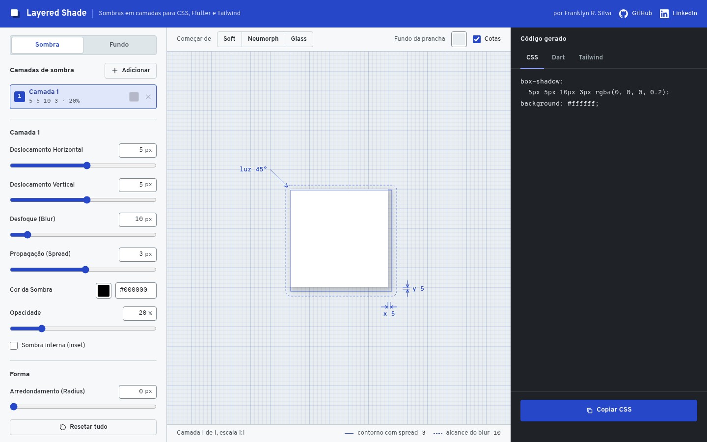

# Layered Shade

Monte sombras em camadas (box-shadow) visualmente e copie o mesmo resultado em **CSS**, **Flutter/Dart** (`BoxShadow`, `BoxDecoration`) ou **Tailwind**.

[🇺🇸 English](../../README.md)

[](https://layeredshade.netlify.app/)
[](https://github.com/Franklyn-R-Silva/Layered-Shade/actions/workflows/ci.yml)
[](../../LICENSE)
[](https://www.bestpractices.dev/projects/17195)



## Por quê

A maioria dos geradores de sombra para no CSS. O Layered Shade trata o Flutter como alvo de primeira classe: um só modelo de sombra, três exportações que batem entre si, e os limites do Flutter avisados onde eles se aplicam, em vez de escondidos.

## Funcionalidades

### Sombras

- **Camadas**: adicione, selecione e remova camadas; cada uma tem deslocamento X/Y, blur, spread, cor, opacidade e inset.
- **Preview medido**: a caixa é desenhada em escala 1:1 sobre uma grade, e as cotas mostram o deslocamento da camada selecionada, o contorno com spread, até onde o blur chega e de onde vem a luz. Ligue e desligue em **Cotas**.
- **Presets**: Soft, Neumorph e Glass como ponto de partida.

### Fundo e forma

- **Gradientes**: empilhe gradientes lineares e radiais, com quantas cores quiser, sobre uma cor base sólida.
- **Forma**: border radius; a cor do fundo do preview também é ajustável.

### Exportação

- **CSS**: `box-shadow`, `background` e `border-radius`, uma camada por linha. O painel mostra exatamente o que é copiado, com a camada selecionada destacada.
- **Dart/Flutter**: `BoxDecoration` com os `BoxShadow`, pronto para colar num `Container`.
- **Tailwind**: classes de valor arbitrário `shadow-[…]` e `bg-[…]`.
- **Copiar**: um botão para o formato ativo, com confirmação anunciada a leitores de tela.

## Limitações conhecidas

- **`inset` no Flutter**: o `BoxShadow` do Flutter não tem inset. Quando uma camada é interna, a aba Dart avisa e mostra o comando para instalar o [`flutter_inset_box_shadow`](https://pub.dev/packages/flutter_inset_box_shadow).
- **Vários gradientes no Flutter**: o `BoxDecoration` aceita um gradiente só, então o Dart exporta o do topo (gradiente 1). CSS e Tailwind exportam todos.
- **Cores só em hexadecimal** (`#RGB` / `#RRGGBB`).

## Acessibilidade

- Todo controle tem rótulo visível; campo numérico e slider andam juntos e são limitados a valores válidos.
- A troca de painel e as abas de exportação seguem o padrão de abas do WAI-ARIA (setas, Home, End).
- Foco visível em tudo, link para pular direto ao preview e respeito a `prefers-reduced-motion`.
- Sucesso e falha ao copiar são anunciados numa região live.

## Stack técnica

| Tecnologia     | Uso                                                        |
| -------------- | ---------------------------------------------------------- |
| **Svelte 5**   | UI reativa com runes (`$state`, `$derived`)                |
| **TypeScript** | Estado, lógica e componentes tipados                       |
| **Vite**       | Servidor de dev e build de produção                        |
| **CSS**        | Custom properties, Grid; fontes Overpass hospedadas no app |
| **Vitest**     | Testes de unidade do núcleo e de integração (DOM)          |

## Arquitetura

Um **núcleo de lógica puro, sem framework**, com uma **UI reativa** fina por cima:

```text
src/
├── App.svelte           # Barra superior + as três colunas de trabalho
├── main.ts              # Monta o app
├── App.test.ts          # Testes de integração (happy-dom)
└── lib/
    ├── shadow.ts        # Estado puro + geração de código (CSS/Dart/Tailwind)
    ├── shadow.test.ts   # Testes de unidade (sem DOM)
    ├── state.svelte.ts  # Singleton $state + actions + flags da UI
    ├── tabs.ts          # Teclado nas abas ARIA
    ├── types.ts
    ├── config/controls.ts
    └── components/      # Control, LayerList, BackgroundPanel, PreviewBox, CodeOutput, …
```

Veja [ARCHITECTURE.md](ARCHITECTURE.md) para os detalhes e [DESIGN.md](../../DESIGN.md) para o sistema visual.

## Como usar

Use online em [layeredshade.netlify.app](https://layeredshade.netlify.app/) ou rode localmente (Node 20.19+):

```bash
git clone https://github.com/Franklyn-R-Silva/Layered-Shade.git
cd Layered-Shade
npm ci
npm run dev      # http://localhost:5173
```

Gere o build com `npm run build` (saída em `dist/`) e sirva o build com `npm run preview`.

## Testes

```bash
npm test               # Testes de unidade + integração
npm run test:coverage  # Cobertura do núcleo de lógica
npm run check          # Type-check (svelte-check)
npm run lint           # ESLint
```

O núcleo (`src/lib/shadow.ts`: mutações de estado e os geradores CSS/Dart/Tailwind) é coberto por testes de unidade sem DOM. O `src/App.test.ts` monta a árvore real de componentes para conferir que a UI acompanha o estado.

## Como contribuir

1. Faça um fork do projeto
2. Crie uma branch (`git checkout -b feature/nova-funcionalidade`)
3. Faça commit das mudanças (`git commit -m 'Adiciona nova funcionalidade'`)
4. Envie a branch (`git push origin feature/nova-funcionalidade`)
5. Abra um pull request

Veja [CONTRIBUTING.md](CONTRIBUTING.md) para as diretrizes e [SECURITY.md](SECURITY.md) para reportar uma vulnerabilidade.

## Autor

Franklyn R. Silva

- GitHub: [@Franklyn-R-Silva](https://github.com/Franklyn-R-Silva)
- LinkedIn: [franklyn-roberto-dev](https://www.linkedin.com/in/franklyn-roberto-dev/)

## Licença

[MIT](../../LICENSE)
